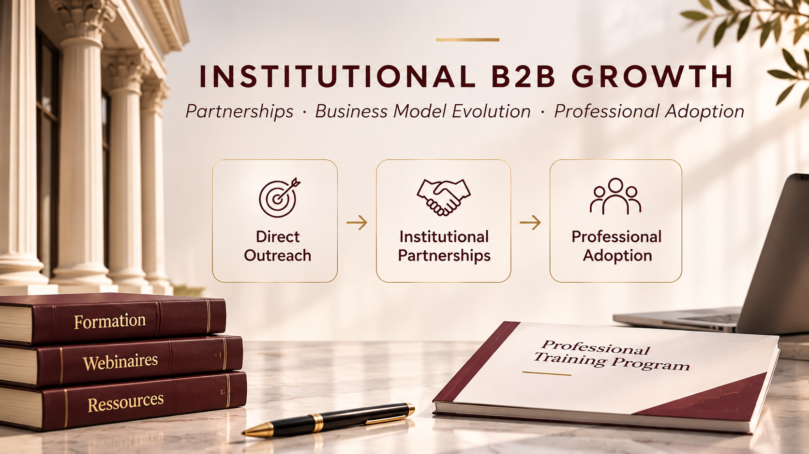

# Flora Minaire

### Marketing leadership · Product strategy · Business development

I turn complex products and emerging market opportunities into clear positioning, actionable go-to-market strategies and commercially relevant execution.

My experience spans founding and leading a technology venture, building fintech marketing foundations, developing institutional B2B partnerships and advising early-stage companies on market entry.

**Contact:** [Email me](mailto:Flora@floraminaire.com) · [LinkedIn](https://www.linkedin.com/in/flora-minaire/)

## Areas of Expertise

**Marketing & Communications:** Brand positioning, digital marketing, content strategy, public relations, growth and demand generation.

**Product & Go-to-Market:** Product marketing, market research, segmentation, value proposition, launch planning and commercialization.

**Business Development:** Institutional partnerships, B2B sales, stakeholder management and international market exploration.

**Leadership:** Founder experience, cross-functional team management, fundraising and strategic execution.

## Selected work
**Four projects. Four different business challenges. One approach: connecting strategy with execution.**

### 01 · Building and leading a LegalTech venture

**Founder & CEO | Venture building · Product strategy · Fundraising**

Founded and led SOLAL TECH, a digital-inheritance technology venture, from market discovery through product development and early B2B commercialization. Directed business strategy, product delivery, fundraising, marketing and cross-functional execution.

**Key results and achievements**

- **€995K in financing secured** across two rounds, combining equity and debt.
- **14-person cross-functional organization** led across technology, product, marketing and operations.
- **Consumer MVP and professional SaaS offering developed**, connecting individuals, beneficiaries and legal professionals.
- **10 paying notary customers** reported in 2024, demonstrating initial B2B adoption.

**Core expertise:** Venture building · Product strategy · Fundraising · Leadership · B2B commercialization

**Estimated reading time:** 9 min

[Explore the case study](https://github.com/flora-builds/legaltech-founder-case-study)

---

### 02 · From product development to marketing launch readiness

**Product marketing lead | Fintech · Positioning · Go-to-market**

Built the marketing foundations for a new consumer fintech proposition, transforming a developing product into a clearly positioned, audience-driven offering. Defined the marketing strategy and coordinated its execution across branding, website, content, commercial teams and external partners.

**Key results and achievements**

- **Marketing and go-to-market strategy approved** by executive leadership.
- **8 audience profiles developed**, covering six consumer segments and two professional-intermediary profiles.
- **Consumer website completed and briefly published**, with marketing copy across approximately 10 pages.
- **60 articles written, 40 published**, alongside finalized educational white papers and launch-preparation materials.

**Strategic contribution:** Established a differentiated, wealth-oriented positioning and connected segmentation, messaging, content and acquisition planning into one coherent customer journey.

**Commercial status:** Launch activation was paused pending regulatory authorization; acquisition and conversion results were not measured.

**Core expertise:** Product marketing · Market positioning · Customer segmentation · Content strategy · GTM execution

**Estimated reading time:** 10 min

[Explore the case study](https://github.com/flora-builds/fintech-gtm-case-study)

---

### 03 · From market gap to institutional B2B adoption

**Co-founder | Institutional sales · Partnerships · Business model development**

Co-founded and commercialized a specialist professional training and support business in a regulated market. Led institutional relationships, commercial development and marketing, while jointly evolving the offering and shifting distribution toward a more repeatable institution-enabled B2B model.

**Key results and achievements**

- **Approximately 500–600 notaries trained** since March 2025.
- **Around 6 professional chambers** engaged through institutional relationships and program delivery.
- **Participant satisfaction progressed from 8.6/10 to 9.4/10** across successive stages of the offering.
- **Repeatable paid training and support model developed**, combining live education, practical resources and 12 months of ongoing access.

**Strategic contribution:** Reworked the route to market by separating institutional distribution from individual purchasing decisions, while managing long-cycle relationships and translating customer feedback into service improvements.

**Core expertise:** Institutional B2B sales · Partnerships · Business model evolution · Education-led growth · Commercial execution

**Estimated reading time:** 8 min

[Explore the case study](https://github.com/flora-builds/institutional_B2B)

---

### 04 · Exploring market readiness for a digital security product

**Market-entry contributor | Digital security · Product positioning · B2B strategy**

Worked directly with the founder of an early-stage digital security venture to evaluate commercial readiness and explore professional market opportunities. Challenged the technology-led narrative, assessed adoption barriers and developed clearer commercial materials and operator-oriented recommendations.

**Key results and deliverables**

- **Commercial one-pager completed**, translating technical capabilities into a professional value proposition.
- **Sales pitch deck developed and delivered** to support prospective partner discussions.
- **Operator-readiness requirements assessed**, including onboarding, responsibilities, positioning and commercial adoption barriers.
- **Prospective partner discussions initiated**, including interest from a North American legal professional.

**Strategic contribution:** Identified the gap between technical differentiation and professional adoption, and proposed a staged approach to market validation and operator-led distribution.

**Commercial status:** Exploratory engagement; no signed customers, completed pilot or commercial launch confirmed.

**Core expertise:** Market-entry strategy · Product positioning · B2B GTM · Commercial validation · Partner development

**Estimated reading time:** 5 min

[Explore the case study](https://github.com/flora-builds/deeptech-market-entry-case-study)

---

## About this portfolio

These case studies illustrate my experience across entrepreneurship, strategic marketing, product development, institutional business development and go-to-market execution.

They document real responsibilities, strategic decisions, completed deliverables and business outcomes. Commercial achievements are distinguished from exploratory work and recommendations.

Selected details have been anonymized to respect confidentiality.

This portfolio presentation was structured and edited with AI assistance. The underlying experience, responsibilities and factual account were provided and reviewed by me.

**[Connect with me on LinkedIn](https://www.linkedin.com/in/flora-minaire/)**

---

## Let's connect

Interested in discussing marketing leadership,
product strategy or business development opportunities?

**[Get in touch by email](mailto:Flora@flora.minaire.com)**
  
