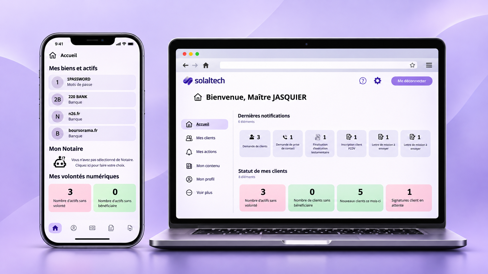

# Flora Minaire

### Marketing Leadership | Product Strategy | Business Development

**SELECTED WORK | PROFESSIONAL PORTFOLIO**

From building a technology venture to shaping fintech go-to-market strategies and developing institutional B2B partnerships.

Explore four selected case studies. Each covers the business challenge, my role, strategic decisions, deliverables and outcomes.

This portfolio presents four selected case studies, with a focus on the challenges addressed, decisions made, responsibilities held and outcomes achieved.

---

## Areas of Expertise

**Marketing & Communications:** Brand positioning, digital marketing, content strategy, public relations, growth and demand generation.

**Product & Go-to-Market:** Product marketing, market research, segmentation, value proposition, launch planning and commercialization.

**Business Development:** Institutional partnerships, B2B sales, stakeholder management and international market exploration.

**Leadership:** Founder experience, cross-functional team management, fundraising and strategic execution.

---

| | |
|:---|:---|
|  |  |
| **01 · FOUNDER & CEO**  **[Building and Leading a LegalTech Venture](https://github.com/flora-builds/legaltech-founder-case-study)**  From market discovery and product development to fundraising and early B2B commercialization. Founded and led a digital-inheritance technology venture, securing approximately €995K in financing and coordinating a 14-person organization.  **Topics:** Product Strategy · Fundraising · Marketing & PR · Leadership · B2B Commercialization  **Estimated reading time: 9 min** | **02 · PRODUCT MARKETING**  **[From Product Development to Marketing Launch Readiness](https://github.com/flora-builds/fintech-gtm-case-study)**  Developed an approved positioning and go-to-market strategy for a consumer fintech proposition. Led audience segmentation, website messaging, editorial production and launch preparation before commercial activation was paused.  **Topics:** Positioning · Segmentation · GTM · Content Strategy · Stakeholder Alignment  **Estimated reading time: 10 min** |
|  |  |
| **03 · INSTITUTIONAL B2B GROWTH**  **[From Market Gap to Institutional B2B Adoption](https://github.com/flora-builds/institutional_B2B)**  Co-founded and commercialized a specialist professional offering in a regulated market. Developed institutional partnerships, led the sales pipeline and helped evolve the distribution model and training experience.  **Topics:** Institutional Sales · Partnerships · Growth Strategy · Business Model Evolution · Professional Education  **Estimated reading time: 8 min** | **04 · MARKET ENTRY & POSITIONING**  **[Exploring Market Readiness for a Digital Security Product](https://github.com/flora-builds/deeptech-market-entry-case-study)**  Worked directly with an early-stage founder to assess professional adoption barriers and refine a market-entry proposition. Produced commercial materials and explored operator-led distribution opportunities.  **Topics:** Digital Security · Product Positioning · Market Exploration · B2B GTM · Partner Development  **Estimated reading time: 7 min** |

---

### About this portfolio

These case studies draw on real professional experience across venture building, product marketing, institutional business development and go-to-market strategy.

They distinguish completed work from strategic recommendations, exploratory activities and unverified commercial outcomes. Certain company and partner details are anonymized to respect confidentiality.

**[Connect with me on LinkedIn](https://www.linkedin.com/in/flora-minaire/)**
  
